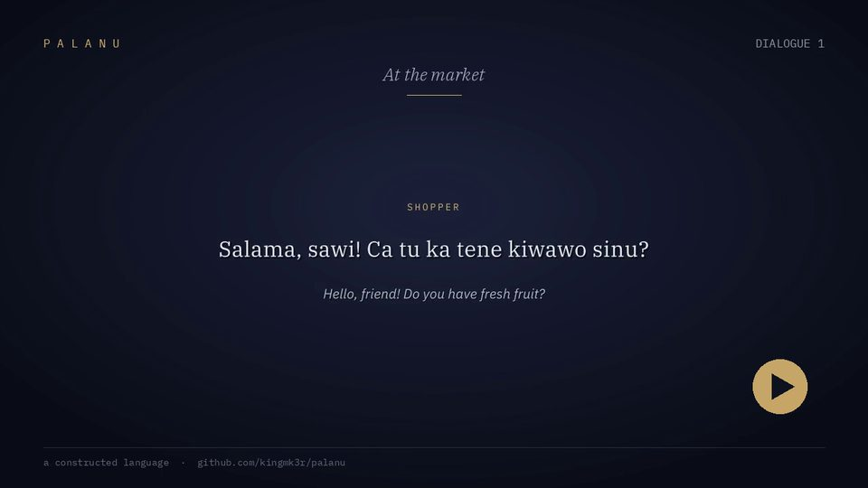
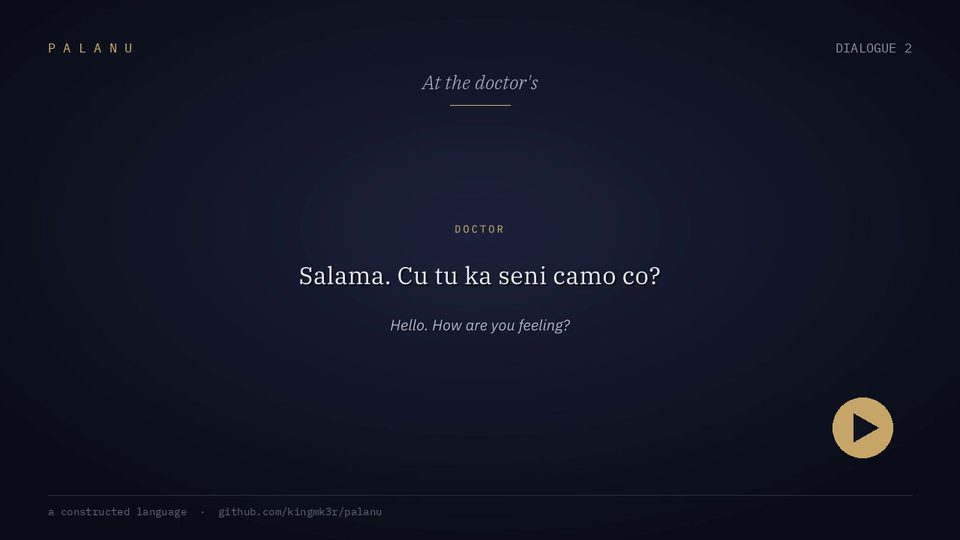
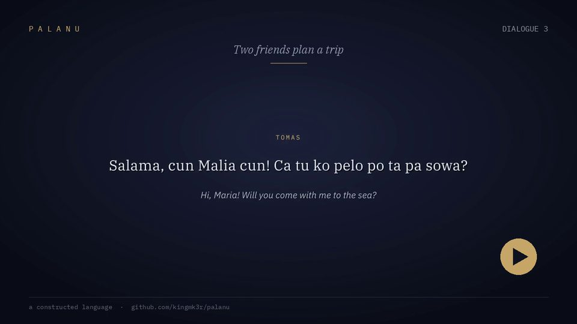
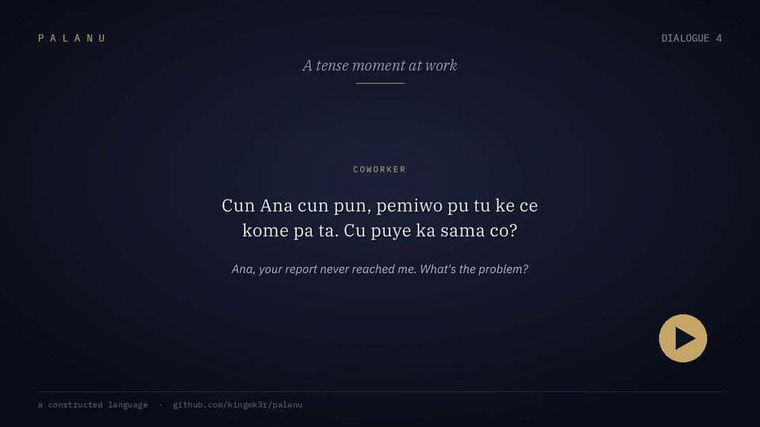
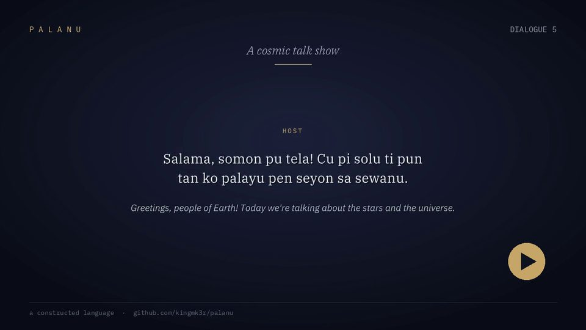
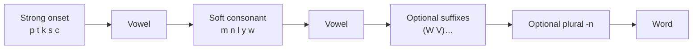
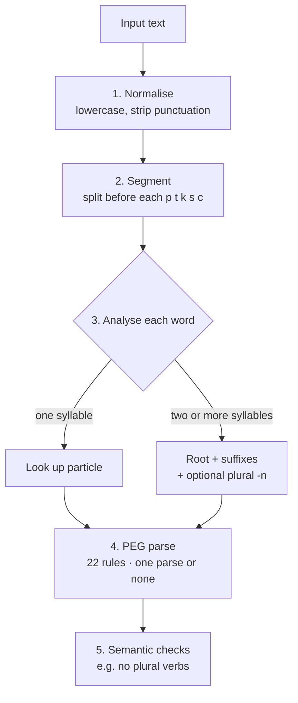

<div align="center">

# Palanu

**Pala ka pelo pin suyu.**
*Speech goes like water.*

[](LICENSE)
[](https://creativecommons.org/licenses/by/4.0/)
[](parser.py)
[](parser.py)

A universal spoken and written language for humans and machines.

15 sounds · one segmentation rule · zero irregularities · one parse or none

[Specification](spec.md) · [Reference parser](parser.py) · [Hear Palanu](#hear-palanu) · [Translations](TRANSLATIONS.md) · [Quickstart](#quickstart)

</div>

---

## Why Palanu?

Palanu is a constructed language you can speak, write, and parse. It uses only fifteen sounds that nearly any speaker already has, marks every word boundary with a single audible rule, and has a formal grammar in which every sentence has exactly one parse or none.

The name is an ordinary word of the language: `pala` *word, speech* plus the collective suffix `-nu`, so **Palanu** means *the whole of speech* — language.

It is designed to be easy to say, easy to hear, easy to write, and easy for a machine to take apart. The grammar is a 22-rule PEG. The reference parser runs that grammar directly: 18 annotated samples parse, and 18 deliberately invalid sentences are rejected.

## Palanu at a glance

| | |
|---|---|
| Sounds | 15 phonemes: `p t k s c` · `m n l y w` · `a e i o u`. No tones, clusters, vowel length or voicing contrast. |
| Word boundaries | **One rule:** every `p t k s c` begins a word, and those five sounds never occur anywhere else. You can find every boundary by ear, in writing with no spaces, or with one regular expression. |
| Word shapes | Particle = 1 syllable (48 of them, closed set). Content word = 2-syllable root + 1-syllable suffixes + optional plural `-n`. You can tell a word's class from how long it is. |
| Morphology | Grammar is carried by separate particles that never change (isolating). New words are built by adding suffixes (agglutinative). There are no paradigms, agreement or exceptions. |
| Syntax | Subject – predicate marker – verb – object, with heads before modifiers. Every clause has one obligatory tense/mood particle, and it marks where the subject ends. |
| Machine side | The grammar is a 22-rule PEG. The reference parser runs it directly, with one parse or none. There are 18 annotated samples and 18 negative tests. |
| Vocabulary | 152 roots. The 39 most frequent are chosen so that no two differ by a single sound. 23 suffixes and phrasal compounding extend them, and 395 root slots are still free. |
| Script | Romanization: 15 plain ASCII letters, one letter per sound, no digraphs. The optional native script, *Semanu*, builds each glyph from how the sound is made. |

## Hear Palanu

Five short conversations, recorded with stock Japanese-native voices from ElevenLabs. Japanese has the same open CV syllables and five-vowel space as Palanu, so it fits the language naturally. Each video shows the Palanu line with an English subtitle. Click a poster to watch, or open the audio. Every line parses with `parser.py`.

Full side-by-side translations, interlinear glosses and a glossary of every word are in **[TRANSLATIONS.md](TRANSLATIONS.md)**.

### 1. At the market

<a href="dialogues/dialogue-1-market.mp4"></a>

▶ [Video (mp4)](dialogues/dialogue-1-market.mp4) · 🎧 [Audio (mp3)](dialogues/dialogue-1-market.mp3) · [Subtitles (srt)](dialogues/dialogue-1-market.srt) · 0:27 · A = Shopper, B = Fruit seller

<details>
<summary>Transcript</summary>

**Shopper:** Salama, sawi! Ca tu ka tene kiwawo sinu?  
*Hello, friend! Do you have fresh fruit?*

**Fruit seller:** Ka! Cu kiwawo pu ta ka sinu, sa to ka pemu. Cu ku sile!  
*Yes! My fruit is fresh and sweet. Take a look!*

**Shopper:** Peya pu kiwawo soluni ka sama co?  
*What is the price of the yellow fruit?*

**Fruit seller:** Peya ka sama kin pa kiwawo ken.  
*It's two for one fruit.*

**Shopper:** Ta ka cana kiwawo san. Ca tu ki tona tiyu tuye?  
*I want five. Could you give me some bread too?*

**Fruit seller:** Ka. Cu peya pu sewa ka sama ken kin. Cu tane, sawi!  
*Sure. The price of everything is twelve. Thank you, friend!*

**Shopper:** Tane! Cu tu ku tene solu poni!  
*Thanks! Have a good day!*

</details>

### 2. At the doctor's

<a href="dialogues/dialogue-2-doctor.mp4"></a>

▶ [Video (mp4)](dialogues/dialogue-2-doctor.mp4) · 🎧 [Audio (mp3)](dialogues/dialogue-2-doctor.mp3) · [Subtitles (srt)](dialogues/dialogue-2-doctor.srt) · 0:25 · A = Doctor, B = Patient

<details>
<summary>Transcript</summary>

**Doctor:** Salama. Cu tu ka seni camo co?  
*Hello. How are you feeling?*

**Patient:** Kemo pu ta ka puwe, sa ta ka pilo.  
*My head hurts, and I have a fever.*

**Doctor:** Puwe ke kome pi temo co?  
*When did the pain start?*

**Patient:** Puwe ke kome pi solu kin pume.  
*It started two days ago.*

**Doctor:** Puye ka ce tawa. Cu ku pinu suyu pulu, sa ku temu pulu.  
*It's not a big problem. Drink lots of water, and sleep a lot.*

**Patient:** Ca ta ka caye sanawe?  
*Do I need medicine?*

**Doctor:** Ka. Cu ku tuma sanawe ti pi solulu.  
*Yes. Take this medicine in the evening.*

**Patient:** Tane, sanayawa! Cu ta ka kiwe so ta ko sana kuwi.  
*Thank you, doctor! I hope I'll get well quickly.*

</details>

### 3. Two friends plan a trip

<a href="dialogues/dialogue-3-trip.mp4"></a>

▶ [Video (mp4)](dialogues/dialogue-3-trip.mp4) · 🎧 [Audio (mp3)](dialogues/dialogue-3-trip.mp3) · [Subtitles (srt)](dialogues/dialogue-3-trip.srt) · 0:30 · A = Tomas, B = Maria

<details>
<summary>Transcript</summary>

**Tomas:** Salama, cun Malia cun! Ca tu ko pelo po ta pa sowa?  
*Hi, Maria! Will you come with me to the sea?*

**Maria:** Ka! Cu ta ka piya sowa. Cu tan ko pelo pi temo co?  
*Yes! I love the sea. When will we go?*

**Tomas:** Tan ki pelo pi solu sin pumeno.  
*We could go in a week.*

**Maria:** Ca tan ko pelo po pelowe se culewe?  
*Will we go by car, or by plane?*

**Tomas:** Culewe ka kuwi, su peya pu to ka tawa. Cu tan ku pelo po pelowe!  
*The plane is fast, but it's expensive. Let's take the car!*

**Maria:** Poni! Cu ta ko puna kula sa suyu.  
*Great! I'll bring food and water.*

**Tomas:** Cu tan ko kana pi camo!  
*Then we'll sing on the road!*

**Maria:** Cu pelo ti ko sama sulo. Tane, sawi!  
*This trip will be beautiful. Thanks, friend!*

</details>

### 4. A tense moment at work

<a href="dialogues/dialogue-4-apology.mp4"></a>

▶ [Video (mp4)](dialogues/dialogue-4-apology.mp4) · 🎧 [Audio (mp3)](dialogues/dialogue-4-apology.mp3) · [Subtitles (srt)](dialogues/dialogue-4-apology.srt) · 0:32 · A = Coworker, B = Ana

<details>
<summary>Transcript</summary>

**Coworker:** Cun Ana cun pun, pemiwo pu tu ke ce kome pa ta. Cu puye ka sama co?  
*Ana, your report never reached me. What's the problem?*

**Ana:** Ta ka seni ponino pen ti. Cu penawe pu ta ke tana.  
*I feel terrible about this. My computer died.*

**Coworker:** Kume ke kiyu. Cu te ke caye pemiwo pi solu ti.  
*The boss was angry. She needed the report today.*

**Ana:** Ta ka kono, sa tu ka tuli. Cu ta ke caye pala pa tu pume.  
*I know, and you're right. I should have told you sooner.*

**Coworker:** Ca tu ki kalo pemiwo sinu pi solulu ti?  
*Could you make a new report by this evening?*

**Ana:** Ka. Cu ta ko kalo to pi solulu ti. Cu ta ka tane tu pan so tu ke tewo.  
*Yes. I'll have it done this evening. Thank you for waiting.*

**Coworker:** Sala, sawi. Cu tan ka kuyu.  
*It's all right, friend. We're a team.*

</details>

### 5. A cosmic talk show: stars, black holes and the expanding universe

<a href="dialogues/dialogue-5-astrophysics.mp4"></a>

▶ [Video (mp4)](dialogues/dialogue-5-astrophysics.mp4) · 🎧 [Audio (mp3)](dialogues/dialogue-5-astrophysics.mp3) · [Subtitles (srt)](dialogues/dialogue-5-astrophysics.srt) · 1:19 · A = Host, B = Co-host

<details>
<summary>Transcript</summary>

**Host:** Salama, somon pu tela! Cu pi solu ti pun tan ko palayu pen seyon sa sewanu.  
*Greetings, people of Earth! Today we're talking about the stars and the universe.*

**Co-host:** Ta ka kono kowa kan pen seyon. Cu seyo ka sama co?  
*I know absolutely nothing about stars. So what is a star?*

**Host:** Seyo ka sama pilo tawama pi sela suma. Cu pi kole pu to pun seyo ka tali cun atom cun tawano pa cun atom cun tawamo.  
*A star is a gigantic fire in the night sky. Deep in its heart, the star fuses small atoms into bigger atoms.*

**Co-host:** Cu cun atom cun tawamo ke pelo pa tolo co?  
*So where did those bigger atoms go?*

**Host:** Pi so seyo tawa ke tana pun to ke pelema, sa cun atom cun ke pelo pa sewanu. Cu pelu pu suyu piloni pu tu ke kome pe seyo! Cu tan sewa ka sama seyonan. Cu ku pena pen to!  
*When a big star died, it exploded, and its atoms flew out into the universe. The iron in your blood came from a star! We are all made of star pieces. Think about that!*

**Co-host:** Cowi! Cu ta ka sama seyo! Cu ta ke kono to pume. Cu pune sumani ka sama co?  
*Whoa! So I'm a star! I knew it all along. And what's a black hole?*

**Host:** Pi so seyo tawama ka tana pun to ki sama pune sumani. Cu pole puma pu to ka tawama, sa kolo ka ce pole pelo pe to.  
*When a giant star dies, it can become a black hole. Its gravity is so enormous that not even light can escape it.*

**Co-host:** Ca pune sumani ki tuma ta? Cu ta ka kowe!  
*Could a black hole grab me? I'm scared!*

**Host:** Ka ce, sawi. Cu to ka tayoma pe tan. Cu pole puma ka kuluya tolo, sa kolo ka tiye tolo kuluyo.  
*No, my friend. It's very far from us. Gravity bends space itself, and light follows that bent space.*

**Co-host:** Ta ke pena so kolo ka pelo pi tali sola!  
*I thought light only travels in a straight line!*

**Host:** Cu sewanu ka tawale! Cu pi so tu ka sile seyo tayo pun tu ka sile kolo so co ke pelo kulu kolo ken kan kan kan. Cu tu ka sile temo pume!  
*And the universe is expanding! When you look at a distant star, you see light that traveled a thousand light-years. You are looking into the past!*

**Co-host:** Sewanu ka tawale, sa tanu pu ta ka tawale tuye, pan kula pulu! Tane, sawi!  
*The universe is expanding, and so is my waistline, thanks to all the food! Thanks, friend!*

</details>

<sub>Voices: Hdo and Madoka (dialogues 1–4), AiMoTo and kaori (dialogue 5), all stock ElevenLabs voices; no real person's voice was cloned. Palanu was respelled in katakana for the speech model (one kana per syllable, `c` → チ-row, final `n` → ン); the text above is the canonical spelling. An earlier Spanish-voiced take is kept in [`dialogues/es/`](dialogues/es/). Notes on the recordings are in [`dialogues/README.md`](dialogues/README.md).</sub>

## The 15 sounds

Only the most common, widely shared sounds of the world's languages. There is no voicing contrast, no `r`/`l` distinction, and no tones.

| | labial | coronal | dorsal / palatal |
|---|---|---|---|
| **Strong** (obstruents, word-initial only) | `p` | `t`, `s` | `k`, `c` /tʃ/ |
| **Soft** (sonorants, word-internal only) | `m`, `w` | `n`, `l` | `y` /j/ |

| | front | back |
|---|---|---|
| high | `i` | `u` |
| mid | `e` | `o` |
| low | `a` | |

Three syllables are banned, to protect fragile contrasts: `ci` (so palatalised `/ti/` never collides with a real `ci`), `yi` (too close to `i`), and `wu` (too close to `u`).

Broad accents are welcome. No single realisation is "correct": `p t k` may be aspirated or voiced, `l` may be `[l ɾ r ɹ]`, and vowels may sit anywhere in their region, as long as they are never reduced to schwa.

## The one rule

> **Every strong consonant begins a new word.**

`p t k s c` occur only at the start of a word. Soft consonants `m n l y w` occur only inside a word (and `n` may also end one). So the word boundaries are exactly the positions of the strong consonants. A listener hears them as crisp obstruent bursts; a machine finds them with one regular expression:

```python
re.split(r'(?=[ptksc])', s)
```

```
takapiyatu   →   ta | ka | piya | tu      "I love you"
```

Spaces are optional. The parser confirms, for every sample, that the space-free sound stream segments into the same words, and that a brute-force count of all valid cuts finds exactly one.

The single exception is a name frame: a word-initial `cun` opens a proper name that runs raw to the next `cun`. Even this is detected by sound.

## Word shape is word class

```
word  =  S V ( W V )* ( n )?
         S ∈ {p t k s c}    W ∈ {m n l y w}    V ∈ {a e i o u}
```

| shape | class | count |
|---|---|---|
| `S V` or `S V n`: **one syllable** | particle (closed class) | 48. Every legal monosyllable is a particle, and every particle is a monosyllable. |
| `S V W V`: **two syllables** | bare root | 152 assigned of 547 possible |
| root + `(W V)*` + `(n)` | derived or inflected content word | open |

Morpheme boundaries inside a word are positional: syllables 1–2 are the root, each later syllable is a suffix, and a final `n` is the plural. `konoyawan` = `kono` + `-ya` + `-wa` + `-n` = *teachers*. A parser never needs to search.



A one-syllable word stops after the first vowel (or that vowel plus a final `n`) and is always a particle. Grammar is isolating — tense, mood, evidence, negation and questions are separate particles that never change — while vocabulary is agglutinative: `kono` *know* → `kono-ya` *teach* → `kono-ya-wa` *teacher* → `kono-ya-wi` *school`.

## How a sentence is parsed



## Sample sentences

Glosses are taken from the specification. Line 1 is the sentence, line 2 splits it into morphemes, and line 3 is the gloss.

**Plain transitive clause**

```
Ta ka piya tu.
ta   ka   piya  tu
1SG  PRS  love  2SG
```
> I love you.

**Yes/no question**

```
Ca tu ka pala palanu?
ca  tu   ka   pala   pala-nu
Q   2SG  PRS  speak  word-COLL
```
> Do you speak Palanu?

**Negation, cause, and coordination**

```
Tan ko ce pelo pan pilu, su tan ko pelo pi solu pumeno.
tan  ko   ce   pelo  pan      pilu  su   tan  ko   pelo  pi  solu  pume-no
1PL  FUT  NEG  go    because  rain  but  1PL  FUT  go    at  day   front-OPP
```
> We won't go because of the rain, but we'll go tomorrow.

**Universal statement (UDHR art. 1, abridged)**

```
Somo sewa ka kayale pi sowi sa sama.
somo    sewa  ka   kaya-le    pi  sowi  sa   sama
person  all   PRS  live-INCH  in  free  and  equal
```
> All human beings are born free and equal.

**Poem: *Suyu* (Water)**

```
Pala ka pelo pin suyu,
pala  ka   pelo  pin   suyu
word  PRS  go    like  water

sa suyu ka pelo pa tolo sewa;
sa   suyu   ka   pelo  pa  tolo   sewa
and  water  PRS  go    to  place  all

cu tolo sewa ka kaya po suyu,
cu   tolo   sewa  ka   kaya  po    suyu
SEP  place  all   PRS  live  with  water

sa somo sewa ka kaya po pala.
sa   somo    sewa  ka   kaya  po    pala
and  person  all   PRS  live  with  word

Cu pala sewa ka sama ken.
cu   pala  sewa  ka   sama  ken
SEP  word  all   PRS  be    1
```
> Speech goes like water,
> and water goes to every place;
> every place lives by water,
> and every person lives by speech.
> All speech is one.

The other thirteen annotated samples — evidentials, relative clauses, conditionals, numerals, names, and more — are in [spec.md](spec.md#82-sample-sentences-with-interlinear-gloss-generated).

## Quickstart

The reference parser is a single Python 3 file with no dependencies beyond the standard library.

```bash
git clone https://github.com/kingmk3r/palanu.git
cd palanu
python3 parser.py
```

A passing run ends with:

```
RESULT: PASS -- 18/18 samples parsed, 18/18 negative tests rejected, lexicon valid
```

Parse a sentence of your own and print the tree:

```bash
python3 parser.py "Ta ka piya tu."
```

Regenerate the generated tables inside `spec.md` (lexicon, grammar, sample glosses, and efficiency figures) from the parser, which is the single source of truth:

```bash
python3 parser.py --update-spec
```

The file is named `spec.md` (not `SPEC.md`) because the parser looks for that path.

## Efficiency, honestly

Palanu does not yet beat English on raw syllable count, and the specification does not pretend otherwise.

Across the 18 sample sentences, Palanu uses **251 syllables** against **188** in plain spoken English — about **34% more syllables**. Because Palanu syllables are simple CV, they can be spoken faster. At the rates Pellegrino et al. (2011) measured for CV languages (7.8 syll/s) versus English (6.19 syll/s), the **estimated speaking time is about 6% longer** than English (ratio ≈ 1.06). That estimate rests on an assumed rate; it is not a measurement of Palanu speakers.

The extra syllables buy something: segmentation by sound, a boundary every parser can see, and zero ambiguity. Palanu wins on evidentials (`con` vs *is said to*) and on digit-string numbers; it loses on disyllabic roots versus English monosyllables, the obligatory predicate marker, name frames, and explicit relative-clause gaps.

Palanu does not beat the ≈39 bits/s human channel described by Coupé et al. (2019), and no language does. The aim is to land near it while staying fully regular and deterministic.

## Known limits

Vagueness is allowed; ambiguity is not. Nouns are number-neutral unless `-n` or a numeral is used, there are no articles, and the present marker `ka` covers both habitual and ongoing action. None of these yields two parses.

Some readings are fixed by grammar rather than by meaning: a prepositional phrase after the verb phrase attaches to the clause, subordinate clauses extend greedily, and stacked modifiers group left to right. The grammar always provides an alternative form for the other reading.

Quantifier scope is resolved by linear order (earlier means wider scope). This is a convention, not yet a formal semantics.

The 48 particles use every legal monosyllable, so neighbours can differ by one vowel or by a coda `n`. Syntax usually turns a mishearing into an ungrammatical sentence rather than a different well-formed one, but this density is a real trade-off against the tier-1 root policy (no minimal pairs). Dropping a final `n` is also a weak point: it never moves a word boundary, but it can change the word.

v1.0 does not settle the native script's code points, a full phonetic timing model, or semantics for idioms.

## Roadmap

Open for v1.1, as listed in the specification:

- Code points for the Semanu script
- A full phonetic timing model
- Semantics for idioms

The lexicon still has **395 free root slots**. Contributions that respect the phonology, the unique-form rules, and the tier-1 no-minimal-pair constraint are welcome.

## Contributing

1. Keep the one rule: strong consonants only begin words; soft consonants only appear inside them.
2. Add no irregular forms, agreement, or stem changes.
3. After any change to the lexicon, grammar, or samples, run `python3 parser.py` and make sure it still reports `RESULT: PASS`.
4. If you change generated tables, refresh them with `python3 parser.py --update-spec` and commit `spec.md` together with `parser.py`.

Issues and pull requests are welcome.

## License

- **Code** (`parser.py` and related software) is released under the [MIT License](LICENSE).
- **The language specification** (`spec.md`, including the phonology, grammar, lexicon, and sample texts) is released under [CC BY 4.0](https://creativecommons.org/licenses/by/4.0/).

---

<div align="center">

*Pala ka pelo pin suyu.*

</div>
